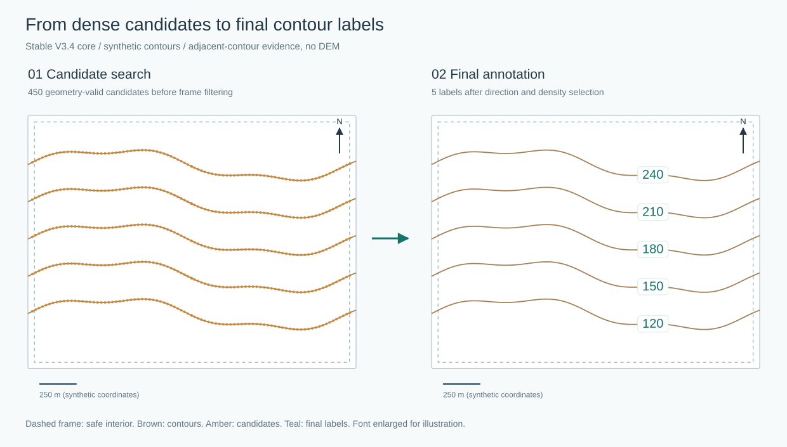
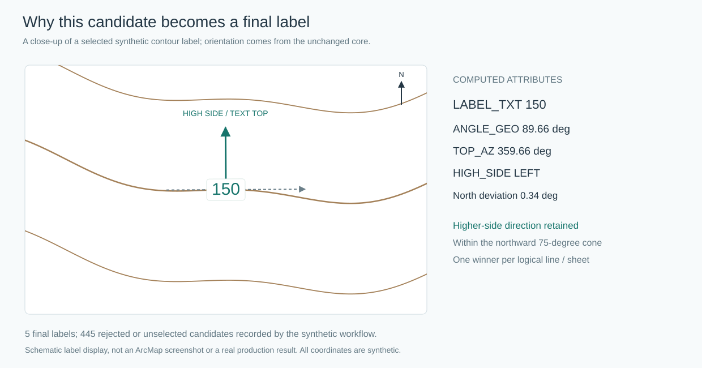

# 自动等高线注记点生成工具

**Automatic Contour Label Placement for 1:10,000 Maps**

面向 1:10000 地形图与公众版地图，从等高线自动生成高程注记点，并计算可供 ArcMap 使用的文字方向。程序基于 Python 3.10、GeoPandas、Shapely、Pyogrio 和 Rasterio，由稳定的 V3.4 脚本整理而来。

仓库只包含源码、占位配置和合成几何测试，**不包含北京市实际生产数据**。用户需要自行提供符合要求的数据，并确认数据及代码的使用、上传权限。

## 效果示意：候选点 → 最终注记

下图使用程序构造的 5 条等高线，调用当前稳定版核心函数，得到 **450 个几何合格候选点 → 5 个正式注记点**。颜色和字号仅用于说明，文字适当放大；这不是实际地形、生产结果或 ArcMap 截图。未使用 DEM。



第二张图放大其中的 150 m 注记，展示实际计算的基线旋转角、字头方位和高侧。最终文字字头朝高侧，并通过北向角约束。



安装项目依赖后，在项目根目录执行 `python examples/make_synthetic_preview.py` 可重新生成这两张 SVG；无需真实 GDB、DEM 或额外绘图库。

## 主要能力

- 支持 `index_only`（计曲线）、`all`（全部等高线）、`both`（一次分析，同时输出主图层和计曲线子集）。各模式均使用全部分析等高线作为地形证据。
- 保留 `OBJE_CODE`；按分类代码与高程序列识别计曲线，可配置自动诊断和保守的降级策略。
- 同高程、同分类线段仅在端点拓扑满足条件时合并，不跨越河流、水库等自然断口。
- 沿逻辑等高线密集生成候选点；避开开放线线头、线尾和图幅边缘，优先选择局部平直弧段。
- 用局部左右法线首先遇到的不同高程等高线判断高侧，DEM 用于一致性检查与证据不足时的回退。
- 字头朝向高侧，默认限于北向 ±75°，北向 ±45° 优先；不独立翻转文字来掩盖高侧冲突。
- 按同一逻辑线/图幅择优，并在同一图幅内进行同高程去密；优先保留计曲线高程覆盖种子。
- 输出正式注记点、reject 质检点、逐线审计点和 CSV 汇总。

## 目录

```text
contour-label-placement/
  contour_label.py
  requirements.txt
  .gitignore
  README.md
  config/config.example.py
  examples/README.md
  examples/make_synthetic_preview.py
  tests/test_core.py
  tests/test_config.py
  tests/test_workflow.py
  docs/RELEASE_AUDIT.md
  docs/PUBLIC_RELEASE_AUDIT.md
  docs/RELEASE_NOTES_v0.1.0.md
  docs/images/
```

本地配置 `config/config.local.py`、自备 `data/` 和运行结果 `outputs/` 均不提交。

## 输入数据要求

| 数据 | 几何与字段 | 要求 |
| --- | --- | --- |
| 等高线 FileGDB | LineString / MultiLineString；`ELEV`、`OBJE_CODE` | 高程可转换为数值，分类代码需核实；坐标系必须为米制投影 |
| 1:10000 标准分幅 FileGDB | 面；`TFBH` | CRS 明确，图幅编号有效；程序会将分幅转换到等高线 CRS |
| 可选 DEM | 第一波段高程 | 有 CRS；高程单位、基准应与等高线一致，正确设置 NoData |

字段名通过 `ELEV_FIELD`、`OBJE_CODE_FIELD`、`TFBH_FIELD` 配置。输出继承这三个配置字段名，不强制重命名。不要使用带空格等无法作为 Python 命名元组属性的字段名；优先使用简单英文字段名。输入无 CRS、经纬度坐标或不一致的高程基准，不能直接用于米级距离判断。

没有 DEM 时，设置 `USE_DEM_FALLBACK = False`；此时仅保留相邻等高线证据充分的候选点，其余进入 reject。设为 `True` 时，DEM 必须存在，不会静默忽略缺失文件。

## 安装

在 Windows PowerShell 中，进入项目目录后执行：

```powershell
py -3.10 -m venv .venv
.\.venv\Scripts\python.exe -m pip install --upgrade pip
.\.venv\Scripts\python.exe -m pip install -r requirements.txt
```

`requirements.txt` 仅列实际直接导入的第三方库，版本来自本次隔离 Python 3.10 环境的安装与测试，不代表已验证所有补丁版本或所有平台。GeoPandas 会自动安装自己的间接依赖。无需安装 ArcPy；ArcMap 仅用于后续制图，不要用 ArcMap 的 Python 2.7 运行此程序。

检查 FileGDB 写支持：

```powershell
.\.venv\Scripts\python.exe -c "import pyogrio; print(pyogrio.__version__, pyogrio.list_drivers().get('OpenFileGDB'))"
```

驱动需返回包含 `w` 的能力（如 `rw`）。不能仅凭包版本认定本机 GDAL 一定支持 FileGDB 写入。

## 配置

```powershell
Copy-Item config/config.example.py config/config.local.py
```

编辑 `config/config.local.py`，保留完整配置。它是可执行的 Python 文件，**只加载可信的配置文件**。所有路径相对于运行命令时的工作目录；默认配置文件本身相对于主脚本定位。

| 配置项 | 含义 |
| --- | --- |
| `CONTOUR_GDB` / `CONTOUR_LAYER` | 等高线数据库 / 图层 |
| `ELEV_FIELD` / `OBJE_CODE_FIELD` | 高程 / 分类字段 |
| `SHEET_GDB` / `SHEET_LAYER` / `TFBH_FIELD` | 标准分幅数据库、图层及编号字段 |
| `DEM_PATH` / `USE_DEM_FALLBACK` | DEM 路径 / 是否启用 DEM 检查与回退 |
| `OUTPUT_GDB` | 专用结果数据库；必须与所有输入路径分离 |
| `INDEX_OBJE_CODES` | 经自己数据字典确认的计曲线代码列表，示例仅为占位值 |
| `ONLY_TFBH` | `None` 为所有图幅，列表为指定图幅 |
| `LABEL_SCOPE` | `index_only`、`all` 或 `both` |
| `OVERWRITE_OUTPUT_GDB` | 默认 `False`；设为 `True` 会删除已有的整个结果 GDB 再写入 |

示例保留 V3.4 的算法阈值：等高距 30 m、计曲线倍数 5、高程起点 0 m、候选步长 25 m、注记地图长度 5.669 mm（地面 56.69 m）、端点净距 33.345 m、图框净距 43.345 m、同图幅同高程最小间距 800 m、北向角限制 75°。这些是原脚本的参数默认值，**不是所有 1:10000 数据的通用规范值**，应按实际数据和文字尺寸核实。

派生参数在配置文件中按顺序计算。修改比例尺、文字长度后，保留后续计算表达式，不要只在主程序中修改某一个结果值。

## 运行

```powershell
.\.venv\Scripts\python.exe contour_label.py
# 或指定其他可信的完整配置
.\.venv\Scripts\python.exe contour_label.py --config config/config.local.py
```

未提供本地配置、仍有占位值或输出与输入路径重叠时，会在读写 GIS 数据前报错。首次建议仅选少量图幅，人工核对注记效果后扩大范围。运行日志输出到控制台；如需保存，可自行重定向至已忽略的 `logs/`。

## 输出

默认输出图层如下（空图层可能跳过）：

| 名称 | 内容 |
| --- | --- |
| `contour_label_master` | 当前处理范围内全部正式注记点；`index_only` 时也仅含计曲线 |
| `contour_label_index` | 计曲线子集；在 `index_only`、`both` 模式输出 |
| `contour_label_reject` | 因几何、图框、高侧、方向或去密等原因未采用的点 |
| `contour_label_line_audit` | 每条逻辑等高线一个审计点，记录最终点数和主要拒绝原因 |

GDB 同目录还会写入 `OBJE_CODE_index_contour_diagnostic.csv`、`contour_label_elevation_coverage.csv`、`contour_label_summary.csv`。这些文件会随运行覆盖，且可能包含真实生产统计信息，默认不提交。

| 字段（默认名称） | 含义 |
| --- | --- |
| `ELEV` | 源高程（名称受 `ELEV_FIELD` 控制） |
| `OBJE_CODE` | 原始分类代码（名称可配置） |
| `LABEL_TXT` | 格式化高程文字 |
| `ANGLE_GEO` | Geographic 方式的文字基线旋转角，0° 北、顺时针 |
| `TANG_AZ` | 候选点局部等高线切线方位角 |
| `HIGH_SIDE` | 相对于原切线方向的 `LEFT` / `RIGHT` 高侧 |
| `TOP_AZ` | 字头法线方位角，朝向地形高侧 |
| `TOP_NORTH_DEV` / `TOP_DIR_CLASS` | 偏离北向的角度 / 方向等级 |
| `SIDE_SRC` / `SIDE_CONF` / `SIDE_VOTE` | 高侧证据来源、一致性比例、有效投票数；比例不是统计概率 |
| `NEAR_L_Z` / `NEAR_R_Z` | 中央法线截面首先遇到的左右相邻线高程 |
| `DEM_L` / `DEM_R` / `DEM_DZ` | DEM 左右采样高程及高差 |
| `LINE_UID` | 基于几何、高程和代码生成的逻辑线标识 |
| `TFBH` | 所属图幅（名称可配置） |
| `IS_INDEX` / `INDEX_CONFLICT` | 计曲线标记 / 分类代码与高程序列冲突标记 |
| `IS_CLOSED` / `LINE_LEN` / `STATION_M` | 闭合标记、线长、沿线里程 |
| `END_CLR_M` / `FRAME_CLR` | 距开放线端点 / 原图框的净距，单位 m；闭合线端距为空 |
| `FLAT_CLASS` / `FLAT_SCORE` | 局部平直程度等级 / 排序分数 |
| `SELECT_STAGE` / `COVERAGE_SEED` | 选择阶段 / 高程覆盖种子标记 |
| `REJECT_REASON` | reject 中的拒绝原因；不同拒绝阶段字段可能不齐全 |
| `FINAL_N` / `DOM_REASON` / `REASON_SUM` | 逐线审计的正式点数、主要拒绝原因、原因计数 |

常见拒绝原因包括 `NO_INTERIOR_AFTER_END_CLEARANCE`、`LOCAL_BEND_TOO_HIGH`、`TOO_CLOSE_TO_FRAME`、`OUTSIDE_STANDARD_SHEETS`、`INSUFFICIENT_ADJACENT_SECTIONS`、`ONE_SIDED_CONTOUR_DEM_CONFLICT`、`TEXT_TOP_OUTSIDE_NORTH_CONE`、`NOT_SELECTED_SAME_LINE_SHEET`、`NOT_SELECTED_LOCAL_SAME_ELEV`。reject 表示该候选未被采用，不一定表示源线错误。

## ArcMap 10.2.2 标注设置

1. 标注字段选 `LABEL_TXT`。
2. 按字段指定角度，旋转字段选 `ANGLE_GEO`。
3. `Rotation Style = Geographic`。
4. **不勾选** `Place label perpendicular to the angle`。
5. 不要让标注引擎再次自动翻转已经计算好的方向（例如额外的 180° 保持朝上翻转）。

程序产生的是注记点和方向属性，不是最终注记要素类。字体、实际文字长度、碰撞和引擎设置仍需人工检查。本次测试不包含 ArcMap 界面验收。

## 算法流程

```text
加载可信配置 → 占位值与输出路径检查
  → 读取等高线与分幅 → CRS / 字段检查 → 可选图幅分析缓冲区
  → 分类代码诊断 + 计曲线标记（全部等高线保留为高侧证据）
  → 按处理范围选择源线 → 同高程同类端点连接 → 逻辑线
  → 密集候选点 → 端点避让 / 平直段硬筛选 → 图幅安全区
  → 左右法线第一条不同高程线 → 多截面高侧投票
  → 可选 DEM 一致性检查与回退 → 字头朝高侧 / 北向角筛选
  → 高程覆盖种子 → 逻辑线与图幅择优 → 同图幅同高程去密
  → 正式点 + reject + 逐线审计 + 高程覆盖与汇总 CSV
```

多截面强双侧相邻线证据与 DEM 冲突时，原算法保留等高线判断并标记 `ADJ_CONTOUR_STRONG_DEM_CONFLICT`；较弱的单侧推断与 DEM 冲突则按配置拒绝。并非所有 DEM 冲突都会拒绝。

## 测试与兼容性

```powershell
.\.venv\Scripts\python.exe -m compileall -q contour_label.py config tests
.\.venv\Scripts\python.exe -m unittest discover -s tests -v
```

测试使用内存合成几何和临时文件，覆盖方位角、LEFT/RIGHT 与字头方向、闭合线绕回、线头线尾距离、北向角筛选、平直度、端点连接与自然断口、图框边距、相邻线高侧判断、计曲线筛选和去密。另测试配置加载及路径保护。实际执行结果和算法保留检查见 [发布检查记录](docs/RELEASE_AUDIT.md)。

## 当前限制与注意事项

- 未使用真实北京数据进行本次测试，不声称完整生产结果与旧版逐点一致。函数逻辑保留检查与合成测试不能替代实际数据验收。
- 距离逻辑依赖米制投影；原校验会拒绝经纬度 CRS，但不会自动识别所有非米制投影，应自行检查坐标轴单位。
- `ONLY_TFBH` 为调试范围，不代表图幅外所有地形均无影响；分析缓冲和完整源线机制按原算法保留。
- 闭合判断沿用 Shapely `is_ring`；自交或不完整的环不一定被当作闭合线，建议先做几何质检。
- 高程覆盖种子优先于密度控制；不存在合格候选时，只记录缺失并警告，不会为达到覆盖率强行生成违规点。
- 不是全要素制图碰撞引擎；同高程去密按图幅分组，相邻图幅交界和其他地图要素仍需检查。
- 沿用原脚本的内存候选列表和 reject 输出策略，大区域或密集线可能占用较多内存和磁盘。
- 为保持兼容，保留 GeoPandas 0.14.x 的 `unary_union` 回退；FileGDB 输出使用 `use_arrow=False`，不引入新版专用 API。
- 原有 `MIN_LOGICAL_LINE_LENGTH_M`、`REQUIRE_INDEX_ELEVATION_COVERAGE`、`PREFER_LARGER_FRAME_CLEARANCE` 未被执行流程读取，保留为兼容参数。高程覆盖与图框排序按原代码执行，不能依靠后两个开关关闭。`PREFER_NORTHWARD_TEXT_TOP` 仅用于汇总记录，不负责关闭北向筛选。
- `OVERWRITE_OUTPUT_GDB=True` 会删除整个专用结果库。路径检查不能判断某个独立路径是否仍是重要数据库，请先备份。
- 本地配置含路径，运行日志可能含路径、图幅和统计信息；不要手动强制加入 Git。`.gitignore` 不会阻止 `git add -f`。

## 数据隐私与首次上传

仓库不包含北京市实际生产数据，用户需要自行提供符合要求的数据。默认忽略本地配置、GIS 数据、CSV、日志、缓存和输出目录；发布前仍应审查 Git 暂存区。首次远程仓库应为 **Private**，并在人工确认文件清单与审查结果后才 push。没有添加开源许可证；若要公开并允许他人使用，请由权利人确认授权并选择许可证。

公开前请阅读 [安全审计](docs/PUBLIC_RELEASE_AUDIT.md)：旧提交元数据包含个人联系邮箱，新提交使用 GitHub noreply 邮箱并不能清除旧历史。本次 `v0.1.0` Release 继续保存在 Private 仓库，不表示已批准公开。
